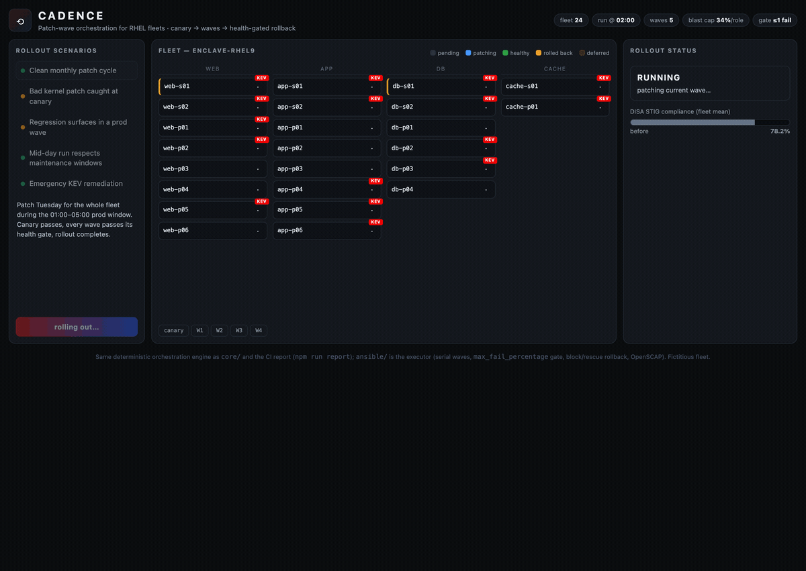
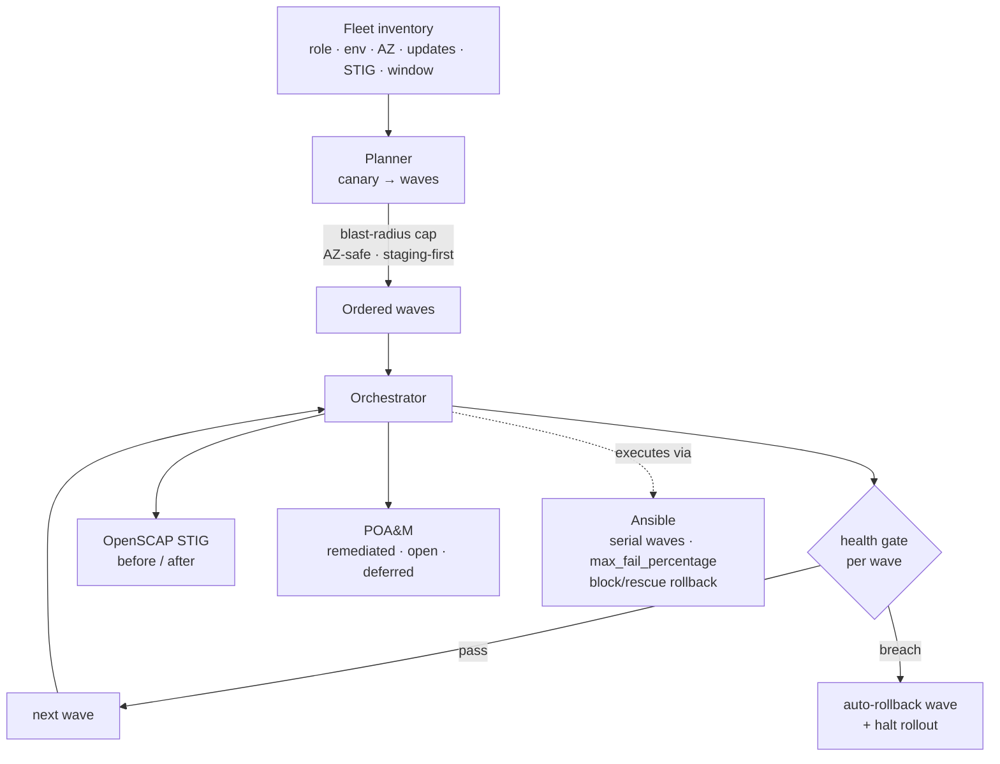

# CADENCE

**Patch-wave orchestration for RHEL fleets — canary, blast-radius waves, and
health-gated automatic rollback.**

CADENCE is the brain of a patch cycle. Given a fleet of RHEL hosts and a set of
pending security updates, it builds a rollout plan — a canary first, then waves
that never exceed a blast-radius cap or take a whole failure domain at once,
promoting staging before prod — and executes it with a health gate after every
wave. The moment a wave fails its post-patch health check, that wave is
**automatically rolled back** and the rollout halts before it can take down the
rest of the fleet. It scores DISA STIG compliance before and after with OpenSCAP
and produces a POA&M of what was remediated and what remains open.

The orchestration engine is deterministic and testable; **Ansible is the
executor** (`ansible/`). This is the Patch-Tuesday / MECM problem for a classified
fleet, done as safe, auditable automation instead of a risky all-at-once push.



**Live demo:** https://cadence-patch-orchestration.vercel.app · run each scenario
and watch the waves, the gate, and the rollback.

---

## The problem it solves

Patching a fleet is a trade-off between **speed** (close the CVE window,
especially for actively-exploited KEV bugs) and **safety** (a bad kernel or
library update can take every host down at once). CADENCE encodes the safe
pattern:

1. **Canary** — patch one or two hosts first; prove the patch before anyone else gets it.
2. **Blast radius** — never patch more than a third of any role concurrently, and never two hosts of the same role in the same availability zone in one wave.
3. **Promotion** — staging is a hard boundary before prod; prod waves only begin once staging is green.
4. **Health gate** — after each wave, a readiness check; if more than the allowed fraction fails, **roll back that wave and stop**.
5. **Maintenance windows** — prod only patches inside its window; an out-of-window run defers those hosts to the POA&M instead of touching them.
6. **Evidence** — OpenSCAP STIG score before/after, and a POA&M that accounts for every CVE as remediated, open or deferred.

## What the scenarios show

| Scenario | Outcome |
|----------|---------|
| Clean monthly cycle | All waves pass the gate; fleet STIG rises, KEV CVEs closed. |
| **Bad kernel at canary** | One canary host never returns healthy → halt at wave 0, canary rolled back, **no prod wave touched**. The canary did its job. |
| **Regression in a prod wave** | Staging passes; two prod hosts fail health → gate breached, that wave auto-rolls-back, rollout halts. Earlier healthy hosts stay patched. |
| Mid-day run | Fires at 14:00; prod (01:00–05:00 window) deferred to the POA&M, only staging patches. |
| Emergency KEV | Out-of-cycle run; planner front-loads KEV/critical hosts into the canary. |

Halting at the canary is a **success of the process**, not a failure — the whole
point of a canary is to catch a bad patch there. The engine distinguishes "halted
at wave 0" (good) from "regression reached a prod wave" (investigate).

## Architecture



`core/` is the orchestration engine and a CI report. `ansible/` is the executor
that runs the same plan on real hosts: `serial: [1, 34%, 34%]` for the in-wave
canary and blast radius, `max_fail_percentage: 25` for the health gate, and a
`block`/`rescue` that restores an LVM snapshot and pins the previous kernel when a
host fails its post-patch readiness check. `roles/openscap` runs
`oscap xccdf eval` against the RHEL 9 STIG profile before and after.

## Certification mapping

- **RHCSA / RHCE** — Ansible playbook/role authoring, `dnf` patch management,
  `serial`/`max_fail_percentage` rollout control, handlers and `block`/`rescue`,
  boot/kernel management (`grubby`), LVM snapshots, inventory and group_vars.
- **CompTIA Security+** — vulnerability & patch management lifecycle, change
  control, maintenance windows, security baselines (DISA STIG/OpenSCAP), and the
  POA&M as the risk-tracking artifact. Mirrors enterprise Patch-Tuesday / MECM
  cycles for a compliance-bound fleet.

## Run it

```bash
npm install
npm test                       # 11 tests: planner caps, gate/rollback, windows, POA&M
npm run report wave-failure    # change-record view of a scenario (add --json for CI)
npm run dev                    # browser console; ?auto runs the walkthrough
```

Execute on real hosts (the engine's plan, materialized as Ansible):

```bash
cd ansible
ansible-playbook patch.yml --limit canary     # prove the canary
ansible-playbook patch.yml --limit staging
ansible-playbook patch.yml --limit prod       # only after staging is green
```

## Layout

```
core/        orchestration engine: fleet model, planner, orchestrator, OpenSCAP
             scoring, POA&M, scenarios, CI report
ansible/     the executor — patch.yml (serial waves + gate + block/rescue
             rollback), roles/patch (snapshot/rollback), roles/openscap, inventory
src/         browser console — same engine, live fleet grid + STIG gauge + POA&M
```

> Lab project. Fleet, hostnames, CVEs-per-host and scores are generated
> deterministically from a seed; the Ansible is real and runnable against RHEL 9.
